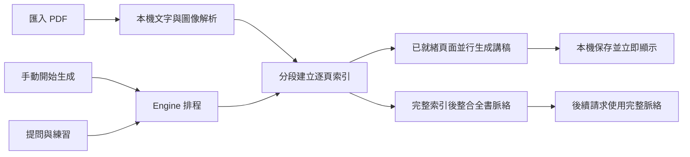

# Study Project

**把 PDF 教材與 AI 導師放在同一個閱讀工作區。**

[](https://github.com/Jay-Huang-0130/study-project/actions/workflows/release.yml)
[](https://github.com/Jay-Huang-0130/study-project/releases/latest)


[下載安裝版](https://github.com/Jay-Huang-0130/study-project/releases/latest/download/Study-Project-Setup.exe) · [功能與使用](#功能) · [本機開發](#本機開發) · [技術文件](docs/README.md) · [Engine 設計論文](docs/ENGINE.md) · [回報問題](https://github.com/Jay-Huang-0130/study-project/issues)

Study Project 是以個人自學為目標的桌面工具。左側自由翻閱 PDF，右側閱讀對應頁面的繁體中文講稿、追問與練習；已完成內容保存在本機，回到同一頁即可接著讀。

目前版本 **0.9.4 / Windows x64 Alpha**。這是公開原始碼的個人專案；其他作業系統尚未驗證，授權條款待作者決定。

## 功能

- **科目群組**：新增、重新命名與移除群組；搜尋後可全選批次移入，移除群組保留教材與學習紀錄。
- **教材首頁**：歷史教材卡片、名稱搜尋、匯入與上次頁碼，開啟後自行選擇繼續閱讀。
- **對頁閱讀**：PDF 與講解左右分割，支援縮放、頁碼跳轉、引用頁面連結、滾輪邊界翻頁及原頁文字選取複製。
- **逐步可讀**：局部索引完成即可生成對應講稿，不必等整份教材分析完。
- **自由控制**：開啟 App、選教材或翻頁都不會自動開始 AI 生成；由使用者按開始／繼續。
- **固定頁碼順序**：背景圖像、索引與講稿從第 1 頁往後派工，翻頁不插隊；續作先補最前面的缺頁，保留已完成快取。
- **並行處理**：AI 請求預設 4、可調 1–6；PDF 背景工作緒預設 2、可調 1–4。講稿完成一頁就補位。
- **頁面問答與練習**：紀錄依教材與頁碼保存；可選最多 10 頁、5 題練習，先作答再看解析。
- **本機快取**：以檔案內容辨識教材，保存 PDF 副本、講稿、問答與進度；可刪除單筆問答或整份教材。
- **可調閱讀介面**：浮動書庫、兩組獨立字級、可展開與搜尋的教材目錄。
- **概念複習地圖**：全書完成後手動生成，串聯術語、英文全名、公式與用法；支援搜尋、拖曳、縮放與來源跳頁。
- **生成診斷**：設定中查看容量排隊、啟動確認、首段回覆與完成耗時；可匯出不含教材內容與登入憑證的本機紀錄。
- **安裝版更新**：自動檢查、背景下載，使用者按「重新啟動並更新」才安裝。

模型連線使用隨程式打包的官方 Codex app-server，透過 ChatGPT OAuth 登入。每位使用者使用自己的帳號與可用額度；模型清單能載入，不代表帳號一定有使用資格或剩餘額度。

## 安裝

| 版本 | 下載 | 使用方式 | App 內更新 |
| --- | --- | --- | --- |
| 安裝版（建議） | [Study-Project-Setup.exe](https://github.com/Jay-Huang-0130/study-project/releases/latest/download/Study-Project-Setup.exe) | 安裝一次，之後點桌面或開始功能表捷徑 | 支援 |
| 可攜版 | [Study-Project-Windows.exe](https://github.com/Jay-Huang-0130/study-project/releases/latest/download/Study-Project-Windows.exe) | 放入可寫入的資料夾後執行 | 手動下載替換 |

使用者不需要安裝 Node.js 或 Git。Releases 的 **Source code** 壓縮檔是原始碼，不是桌面程式。[所有版本與校驗檔](https://github.com/Jay-Huang-0130/study-project/releases)。

> 目前產物尚未簽章，Windows 可能顯示未知發行者或 SmartScreen 提示。自動更新不等於程式簽章。

## 快速開始

1. 開啟 Study Project，在設定中使用自己的 ChatGPT 帳號登入。
2. 點左下角書庫按鈕，匯入 PDF；可以先翻閱原文。
3. 按右下角「開始生成」。每頁講稿完成就可閱讀，其他頁在背景繼續。
4. 自己翻頁、追問，或選擇練習範圍。切換教材不會停止已由你啟動的背景工作。
5. 需要時按「暫停生成」。斷線、用量限制或生成錯誤也會暫停；排除原因後按繼續，補做未完成部分。

每次重新開啟程式，未完成教材都先待命；已保存內容仍可閱讀。繼續會重新產生中斷中的頁面／批次，並非從遠端模型中斷的同一個 token 續接。

### 生成速度診斷

生成時開啟設定 →「生成診斷 · 查看時間花在哪裡」。容量等待較長表示尚在本機排隊；啟動確認較長表示 turn/start 已送出但還沒收到確認；等待首段文字表示已開始卻尚無可讀內容。頁面同時列出圖片、索引和講稿進度。這些資訊能定位客戶端階段，無法直接分辨網路與模型內部的耗時。只記錄本次開啟後的新請求，需要保留可按「匯出診斷紀錄」。[欄位與限制](docs/DIAGNOSTICS.md)。

### 模型啟動等待

新教材先出現部分重點後，下一個模型請求仍可能等待。0.9.2 修復 turn/start 套用一般 60 秒 RPC 期限而提前暫停的問題；單次生成保留 8 分鐘上限，已開始的串流依完成事件判定。真正的額度、網路或生成錯誤仍暫停；排除原因後按「繼續生成」，已完成頁面會保留，不自動反覆送出。

### PDF 閱讀與公式

游標在 PDF 區域時，滾輪先捲動當頁；到頂／底後，停一下再滾動可翻至前／後頁。一個手勢最多翻一頁。可選取原 PDF 的文字並用 Ctrl+C 複製；純掃描圖片沒有文字層時會顯示提示，本版不做 OCR。

講稿顯示端相容多行 `$$`、`\[...\]`、`\(...\)`，也修復可辨識的獨立公式末尾缺少開頭分隔符情況。只調整顯示，不改寫保存內容、不補猜公式；無法解析時保留原式供核對。詳見 [閱讀設計](docs/READING.md)。

### 字級與目錄

設定提供「固定介面／標題」80–150% 與「閱讀內文」12–26 px，互相獨立並自動保存。PDF 有自己的縮放控制。

教材脈絡優先沿用 PDF 內建章節；沒有書籤時每 8 頁分組。展開後顯示頁面主題與短摘要，可搜尋並跳頁。這個目錄不會額外呼叫模型，也不會為沒有書籤的教材猜測章節。

### 概念複習

全書解析、完整脈絡與每頁講稿完成後，切到右上角「概念複習」，按「產生概念圖」才會呼叫模型。此模式隱藏 PDF，提供可展開的主題、具名知識連線與概念詳情。公式附參數、單位與條件，節點和連線都能回到來源頁。

支援搜尋縮寫與英文全名、平移縮放、拖動節點與聚焦關係。地圖和畫布保存在本機，切換或重開不自動生成；可暫停、手動續作或重新產生。進度包含原頁核對與後續整合；每層合併也會保存，重開可接續完成組別。格式驗證錯誤會針對該組最多自動修正一次，仍失敗則保留進度與具體錯誤。教材更新會提示舊圖待更新。[生成規則與驗證限制](docs/CONCEPT-REVIEW.md)。

概念地圖採滿版畫布，搜尋工具可收合；點選節點或連線會顯示浮動資訊卡。拖動標題列移動，四邊與四角皆可拉伸；雙擊標題列放大／還原，也可收起或獨立調整字級。最大化後拖動標題列會還原成一般視窗；重開仍保留還原尺寸。若配置不合適，可按「重設位置與大小」。長公式預設縮放到卡片寬度，可切回原始大小；配置隨地圖保存，既有地圖不必重新生成。

### 科目群組

首頁按「新增群組」，例如線性代數。在全部教材搜尋科目、按「全選目前結果」，選目的群組後移動，可一次管理 21 份教材。每份教材屬於一個群組或未分組；群組內匯入會自動歸入該組，閱讀中的浮動書庫也可篩選科目。群組只管理教材，不啟動 AI，也不產生跨 PDF 關聯。[資料與驗收](docs/GROUPS.md)。

### 更新與資料搬移

安裝版啟動後會檢查更新，完成背景下載後可在設定按「重新啟動並更新」。一般關閉不會自動安裝。更新前保存紀錄並停止生成，重開後仍等你手動繼續。

| 內容 | 預設位置 |
| --- | --- |
| 安裝版教材與學習紀錄 | `%APPDATA%/study-project/library` |
| 可攜版教材與學習紀錄 | EXE 旁的 `StudyProjectData/` |
| 實際使用的資料夾 | 設定 → 開啟資料資料夾 |

教材存於本機，**生成時所需的文字、頁面圖像與相關問答仍會送往模型服務**；不是完全離線的 AI。已保存講稿與原 PDF 可離線閱讀。教材檔案不是加密保險箱，請自行備份。

舊可攜版需先下載安裝版一次，才能取得後續 App 內更新。搬移前關閉程式並備份兩邊資料；將舊資料夾中的 `books/`、`settings.json` 與 `library.json`（群組資料，若存在） 複製到新位置，避免覆蓋不同書庫。跨電腦需重新登入。詳細位置規則見 [架構文件](docs/ARCHITECTURE.md#資料保存與位置)。

## 如何運作



索引是小批次任務；講稿則以單頁為任務，釋出容量便補位，不等待同一輪所有頁面完成。早期講稿會保存建立時的脈絡覆蓋範圍，完整地圖完成後不會偷偷覆寫舊講稿。演算法、偽程式碼與限制見 [Engine 設計文件](docs/ENGINE.md)。

## 本機開發

需要 **Windows x64、Node.js 22.13+、npm**。

```powershell
git clone https://github.com/Jay-Huang-0130/study-project.git
cd study-project
npm ci

# 使用隔離的開發資料，避免碰到日常書庫。
$env:STUDY_USER_DATA = Join-Path (Get-Location) 'local-data/dev-profile'
$env:STUDY_DATA_DIR = Join-Path (Get-Location) 'local-data/dev-library'
npm run dev
```

| 指令 | 用途 |
| --- | --- |
| `npm test` | 核心邏輯、Provider 協定、PDF Worker、閱讀資料與更新測試 |
| `npm run check` | 自動測試、TypeScript 型別檢查與 Vite 正式編譯 |
| `npm run check:codex` | 隔離設定下檢查 app-server 初始化與模型目錄，不發送推論 |
| `npm run build` | 編譯 renderer、main 與 preload |
| `npm start` | 執行已編譯的 Electron App |
| `npm run package` | 編譯並建立 Windows 安裝版與可攜版 |

如果 Electron 執行檔未安裝完整，可執行 `node node_modules/electron/install.js`。開發程序、資料隔離與回歸要求見 [DEVELOPMENT.md](DEVELOPMENT.md)。

## 技術堆疊

| 層級 | 元件 |
| --- | --- |
| 桌面與介面 | Electron、React、TypeScript、Vite |
| PDF | PDF.js、Node Worker Threads、`@napi-rs/canvas` |
| 概念地圖 | React Flow、Dagre |
| 文字與數學 | React Markdown、GFM、KaTeX |
| 模型橋接 | `@openai/codex` app-server、ChatGPT OAuth |
| 保存 | 每份教材 JSON 原子快照與檔案資產，尚未採用 SQLite |
| 發行與更新 | electron-builder、NSIS、electron-updater、GitHub Actions / Releases |

## 文件

| 文件 | 內容 |
| --- | --- |
| [文件導覽](docs/README.md) | 依使用者、開發者與研究閱讀順序整理 |
| [產品規格](SPEC.md) | 0.8.3 行為、範圍與驗收條件 |
| [架構](docs/ARCHITECTURE.md) | 程序、資料、IPC、安全與預覽生命週期 |
| [Engine 設計論文](docs/ENGINE.md) | 問題定義、形式化模型、演算法、驗證與限制 |
| [效能分析](docs/PERFORMANCE.md) | 動態補位、PDF 工作緒、歷史量測與實驗設計 |
| [驗證紀錄](docs/TESTING.md) | 自動測試、桌面驗證與未驗證項目 |
| [發行流程](docs/RELEASING.md) | tag、CI、更新附件與版本發布 |
| [開發紀錄](DEVLOG.md) | 歷史決策、修補與進度 |

## 參與與回報

歡迎透過 [Issues](https://github.com/Jay-Huang-0130/study-project/issues) 回報問題，或依 [貢獻指南](CONTRIBUTING.md) 提出修改。請附 App 版本、重現步驟、預期與實際結果，移除私人教材內容和登入資訊。

目前沒有雲端書庫同步、跨平台交付、OCR 專用管線或自動符號驗算器；模型教學品質仍需對照原頁。自動測試數量與本機 PDF 渲染速度，不代表模型答案正確率。

## 授權

目前倉庫未提供 `LICENSE`，授權條款待作者決定；本 README 不宣告 MIT、Apache 或其他尚未選定的授權。
