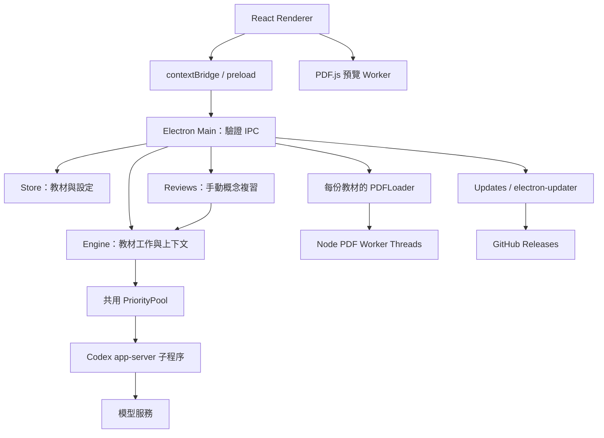

# 系統架構與實作邊界

基準：**0.10.3**；更新日期：**2026-10-27**。Engine 的演算法與上下文細節見 [ENGINE.md](ENGINE.md)，產品驗收見 [SPEC.md](../SPEC.md)。

## 程序與模組



| 模組 | 職責 | 不負責 |
| --- | --- | --- |
| [App.tsx](../src/App.tsx) | 閱讀狀態、講稿、問答、設定、書庫、串流呈現 | 直接讀寫 Node 檔案或保管 token |
| [PDFViewer](../src/PDFViewer.tsx) | 從原 PDF 繪製目前頁、縮放、書籤與重載 | 建立送模型的 JPEG |
| [main](../electron/main.ts) / [preload](../electron/preload.ts) | IPC 驗證、匯入、原頁路由、程序協調與退出 | 模型語義驗算 |
| [Store](../electron/store.ts) | SHA-256 身分、JSON 快照、刪除與啟動恢復 | 跨程序交易或雲端同步 |
| [PDFLoader](../electron/pdf-loader.ts) | 共享頁面派工、每份教材的 Worker 數量 | 模型並行容量 |
| [Engine](../electron/engine.ts) | 索引、講稿、互動、暫停、上下文建構 | PDF canvas 顯示與更新下載 |
| [Reviews](../electron/review.ts) | 全書完成門檻、原頁概念擷取、來源驗證、分層整合、地圖快取 | 自動啟動生成或證明語義正確 |
| [ConceptReview](../src/ConceptReview.tsx) | React Flow 畫布、Dagre 排版、來源跳頁與畫布保存 | 呼叫 Node 或保管登入資料 |
| [PriorityPool](../electron/priority-pool.ts) | 實際 Provider 呼叫的共用容量與佇列優先級 | 搶占已開始的遠端請求 |
| [CodexClient](../electron/codex.ts) | OAuth app-server、模型清單、RPC、串流及中斷 | 共享永久模型對話記憶 |
| [Updates](../electron/updates.ts) | 檢查、背景下載、明確安裝動作與錯誤狀態 | Windows 程式簽章 |

Renderer 啟用 context isolation、停用 Node integration 並使用 sandbox。IPC 僅接受應用主視窗的 main frame。`study://book/<sha256>/source.pdf` 與 `pN.jpg` 路由驗證教材存在、識別格式與檔名，不提供任意檔案瀏覽。

## 從匯入到可閱讀

1. Store 依 PDF 位元組計算 SHA-256，複製原檔至書庫；相同內容沿用已有紀錄。
2. 匯入可啟動本機 PDFLoader 供預覽與資產準備；AI 保持暫停。
3. 明確開始／繼續後，Engine 才讓教材加入背景生成。全文文字先行，圖像依實體頁碼升序準備，翻頁不重排背景工作。
4. 局部索引完成就保存地圖、開放相應講稿；每頁講稿完成立即保存，不等待全書總覽。
5. 同一會話已啟動的多份教材輪替派工；問題、講稿與索引共享模型容量。
6. 完整索引再整合 overview / terms / links。早期講稿保留建立時覆蓋範圍，未經手動操作不被背景覆寫。

單純啟動 App、選教材、翻頁、登入或改設定不啟動教材 AI 生成。明確送問題、出題或重新講解也是模型操作，與背景自動開始不同。

## 資料保存與位置

```text
<library>/
├── library.json        # 群組及教材歸屬（可選）
├── settings.json
└── books/<PDF SHA-256>/
    ├── source.pdf
    ├── book.json
    ├── p1.jpg
    └── p2.jpg ...

<userData>/
├── data-location.json   # 自訂書庫位置，便於安裝更新後重啟
├── oauth/              # 獨立 Codex 設定，憑證使用系統 keyring
└── tutor-runtime/      # app-server 工作目錄
```

資料根目錄選擇順序為：

1. `STUDY_DATA_DIR`。
2. 完整路徑參數 `--study-data-dir=`。
3. 可攜模式的 EXE 相鄰 `StudyProjectData/`。
4. 非可攜模式已保存的 `userData/data-location.json`。
5. `userData/library`；一般 Windows 安裝版為 `%APPDATA%/study-project/library`。

`STUDY_USER_DATA` 可隔離整份應用設定；不要讓不同 profile 的程序共寫同一 library。單一實例鎖不能代替跨書庫的多程序資料庫鎖。

`book.json` 包含頁面文字、講稿、索引、訊息與閱讀位置。保存以 flush 暫存檔再 rename 替換；尚未使用 SQLite。沒有跨 PDF、JPEG、JSON 的完整交易，也沒有預設教材加密或遠端備份。

### 啟動恢復與快取

- 清除前次 `generationStarted`；未完成教材先暫停，等待手動開始。
- 中斷的 running 索引、講稿、問答與解析恢復 pending；不將半段文字當 done。
- 已完成內容保留，改模型或講解長度只套用新工作。
- 讀取到損毀 JSON 會明確報錯，不靜默覆寫。

### 刪除

整份教材需確認後才刪除。主程序先取消模型工作、清除延遲寫入並等待 PDF Worker 停止，再移除經驗證的 `books/<sha256>` 目錄。原匯入位置的 PDF 不受影響。

單筆問答先原子保存移除後快照，再更新記憶體；running 訊息不能刪除，pending 可刪除。後續上下文只取仍存在的紀錄。Store 與 Engine 均核對書本物件身分，防止刪除後的晚到工作重建資料。

## 模型橋接與資料流

每次 Provider 請求建立 ephemeral thread，明確帶入文字、必要原頁圖像和上下文；不依賴其他獨立請求的隱含記憶。問答最多帶最近 8 筆完成紀錄。一般來源原頁上限 6 頁，帶練習範圍者最多 12 頁。

程式啟動獨立 `CODEX_HOME`，設定系統 keyring，清除子程序中的 API Key 環境變數。停用工具、shell、web search、apps、hooks、多代理；收到工具 RPC 會拒絕。原始 stderr 不直接送至介面。

本機保存不代表推論完全離線：生成所需教材文字、圖像及問答會交給模型服務。教材內容與模型補充須區分；schema 驗證僅保證結構，不是事實驗證。圖像讀取不清、跨頁來源不足及提示注入仍可能影響回答。

## 預覽與背景解析分離

PDF.js renderer 直接讀 `source.pdf`，Node Workers 另產生模型使用的 JPEG；二者不共用 PDFDocumentProxy。

0.7.1 預覽以教材 id 分開掛載，載入狀態包含 id / revision，禁止新工作使用已銷毀的舊文件。繪製先在獨立 canvas 進行，僅有效工作提交可見畫布。取消與過期結果不覆寫新頁。

錯誤時 canvas 仍保留，提供「重新載入 PDF」；revision query 避免沿用失敗回應。有效渲染遇到 transport 銷毀最多自動重載一次。此路徑不呼叫模型，也不刪除講稿。

## 閱讀呈現

字級存於 `uiScale / readingFontSize`，主程序驗證範圍；介面／標題與內文用獨立 CSS variables。PDF 縮放保持獨立。

教材目錄從已載入 PDF 讀取書籤、解析成實體頁碼，與已有逐頁索引合併；沒有書籤則每 8 頁分組。摘要為既有文字的第一句／最多 64 字，不是額外生成的章節總結。教材目錄只影響呈現；內部 overview / terms 仍供教學上下文使用。

## 暫停、串流與通知

每個 Engine job 有 AbortController。暫停取消 Pool 等待項目，向在途 Provider 送出中斷，回復未完成狀態並停止相關 PDFLoader。遠端停止與用量扣抵不具零延遲保證。

主程序對狀態變更約 60ms 合併通知；文字擷取的保存約 250ms 合併；串流事件約 100ms 合併發往 renderer。模型串流不等於完成快取；最終回答通過結果接受條件才標為 done。

## 安裝與更新

安裝版為 per-user NSIS。透過安裝目錄的 uninstaller 識別，啟動約 4 秒後查詢公開 GitHub Releases。可攜版與一般 win-unpacked / 開發模式不啟用 App 內更新。

Updates controller 收到新版後開始背景下載，由 electron-updater 依 metadata 驗證檔案；`autoInstallOnAppQuit=false`、不允許降版。使用者按「重新啟動並更新」才先保存、停止工作，再執行 installer 並重開。自訂書庫路徑保存至 userData，避免 installer 重啟丟失 CLI 參數。

發行包含版本化 Setup EXE、blockmap、latest.yml、固定下載別名與 SHA256SUMS。現版未簽章；下載完整性檢查不等於受信任發行者簽章。完整流程見 [RELEASING.md](RELEASING.md)。

## 現階段限制

- 只驗證 Windows x64；另一台實體電腦及其他平台尚需驗收。
- 沒有獨立語義正確率基準、符號驗算器或 OCR 專用管線。
- 全書索引與速覽的長度尚無 token 預算器；長文件仍可能超出上游限制。
- JSON 隨教材、講稿與問答增長，沒有跨程序寫入交易。
- 問答沒有永久保留容量；先於排隊背景工作不代表能搶占在途請求。
- 語音、雲端同步、區域框選高亮、成績報表尚未實作。

## 手動概念複習

Reviews 經 Engine.generateReview 使用同一模型容量（優先級 2），保持一般教材生成資格獨立。ReviewRecord、完成圖及 ReviewView 一起存於教材 book.json；啟動時 running 恢復成 paused。原頁每 4 頁 checkpoint，各層合併也逐組 checkpoint；整合圖成功後才替換舊圖；晚到結果以物件身分、來源版本及 AbortSignal 阻擋。完整方法、上限與來源證明邊界見 [CONCEPT-REVIEW](CONCEPT-REVIEW.md)。

## 閱讀呈現擴充（0.8.1）

LibraryHome 使用 BookSummary 與 groups；群組 IPC 僅更新本機管理資料，不觸發 AI。PDFViewer 同一份 viewport 同時建立 canvas 與 PDF.js TextLayer；皆完成且作業仍有效才提交，換頁清除舊文字層，取消時中斷兩者。滾輪只綁定 PDF 容器，PDFWheelPager 管理邊界與手勢。Markdown 顯示前以 normalizeMath 修復分隔符，原始 book.json 不變。相關檔案與限制見 [READING](READING.md)。

## 合併驗證恢復（0.8.3）

Reviews 在整合前隔離各子圖局部 ID，收回輸出後先去除完全相同的重複紀錄，再做嚴格驗證。checkedGraph 只對驗證錯誤最多補發一次修正；validationFailure 保留本組錯誤與有限大小的無效輸出，不影響成功快取。模型額度與網路錯誤仍由使用者手動處理。

## 0.9.0 群組與浮動地圖

群組資料由 Store 以 library.json 原子保存，透過四個受信任 IPC 管理；不寫入每本 book.json，不影響來源指紋。詳見 [GROUPS](GROUPS.md)。ReviewView 新增可選 panel 與 toolsOpen；舊圖沿用預設位置與收合工具。FloatingInfo 使用 Pointer Capture 拖移／拉伸，ResizeObserver 限制於畫布內；FitFormula 只縮放顯示，保留原 LaTeX。保存欄位有有限數值及尺寸驗證，畫布仍存於原教材。

0.9.1：panel-layout 集中管理一般／最大化／還原／八方向拉伸的純幾何狀態。normalBounds 與 maximized 隨教材視圖原子保存；主程序驗證模式布林值與還原矩形的有限數值及上限。浮動視窗不再依賴暫存 ref 作為唯一還原來源。

## 0.9.2 模型啟動期限

一般 RPC 保持 60 秒；generate 使用獨立 8 分鐘生命週期，turn/start 回覆等待最多 8 分鐘加 30 秒的晚到 ID 清理寬限。turn/started 已帶有效 ID 時可視為啟動接受，取消對應 RPC 的本機等待並繼續接收內容；完成事件也清除尚未回覆的啟動 RPC。取消或期限到達後禁止輸出回寫，若 ID 晚到則精確 interrupt 後 unsubscribe。沒有 ID 時不送空字串，也不把 unsubscribe 當取消。連線錯誤與 RPC 錯誤統一清理計時器和監聽。單次失敗不自動重送，Engine 依既有機制暫停該教材並保留成功頁面。

0.9.3：PDFLoader.assign 依頁碼派工，orderedPages 只做數值升序；nextIndexPages 跳過快取索引並在第一個未就緒圖像處停止收集，nextPage 等待最前 pending 頁的圖像與索引。導航仍保存閱讀位置並喚醒既有排程，但不影響任何教材的頁碼順位。

## 0.9.4 生成診斷

Engine 在共用 Pool 前註冊請求、進槽後記錄 Provider 開始，CodexClient 以可選回呼回報連線、thread/start、turn/start、接受及第一份非空 agentMessage。原始 RPC payload 不變，觀測不觸發額外模型請求。診斷只存有界記憶體；設定面板展開時才每秒讀取，手動匯出以 atomicJSON 寫入書庫根目錄。詳見 [DIAGNOSTICS](DIAGNOSTICS.md)。

## 0.10.0 單請求多頁講稿

Engine 的全域 Provider 容量固定為 1，涵蓋講稿、索引、總覽、問答與概念圖。索引首批最多 5 頁、後續最多 10 頁；講稿每批最多 5 頁，按密度與講解偏好縮小。新增 lesson-batch.ts 解析獨立 JSON 頁面紀錄，完整頁即保存，不等整批。舊 aiConcurrency 設定自動遷移為 1，PDF Worker 不變。截斷或取消保留完成頁，續作重做未完成頁。詳見 [Engine](ENGINE.md)。
