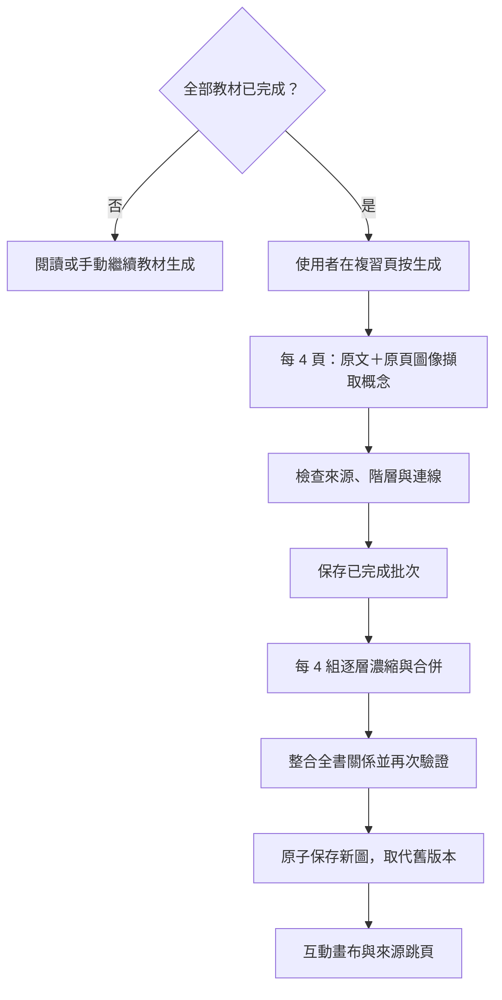

# 概念複習：由原頁到可追溯的知識地圖

版本：**0.9.4**；日期：**2026-10-26**。

## 使用流程

1. 先以原本的教材閱讀模式完成整份 PDF 的解析、全書脈絡與所有逐頁講稿；未完成問答也需先結束。
2. 右上角切換「概念複習」。切換會隱藏 PDF，將空間交給互動畫布與概念詳情，不會呼叫模型。
3. 按「產生概念圖」才開始整理；尚未完成教材或尚未登入時不能啟動。每份教材各自保存地圖。
4. 展開主題、搜尋縮寫／全名／中文／公式，點節點查看定義、公式、符號單位與適用條件。點跨概念連線可查看關係與引用。
5. 點來源頁回到教材閱讀；再切回複習，保留節點位置、視角、展開狀態與選取概念。篩選與聚焦是臨時操作。

拖動空白處平移，滾輪縮放，節點可拖曳；提供縮放控制、縮圖、類型篩選、全部展開與重設排版。它是一份濃縮概念圖，不保證逐項列出教材所有細節，也不是任意繪圖編輯器。

## 方法與依賴

此流程由主程序的 [Reviews](../electron/review.ts) 協調，透過 `Engine.generateReview` 使用同一個 PriorityPool 與 OAuth Provider。優先級為 2，與索引相同，低於排隊中的問答與講稿。單份地圖目前逐批處理，讓完成檢查與 checkpoint 有清楚邊界；不新增無上限請求，也不改變原本逐頁講稿的動態補位排程。

全書 `overview` 與逐頁索引只供定位；擷取的主要材料是每頁完整提取文字與對應 JPEG。批次不以生成講稿當成原文。擷取每批最多 12 個節點／24 條連線，中間整合最多 40／80，最終最多 80／160。所有數量上限都在收到結果後檢查，超量會顯示錯誤，由使用者手動重試。

令 `N` 為頁數、`K=ceil(N/4)` 為擷取批數。擷取完成後，以最多 4 組圖為一組反覆合併，直到剩最多 4 組，再整合一次。例：100 頁為 25 次擷取、7+2 次中間合併、1 次全書整合，共 35 次成功請求；錯誤重試另計。此數字描述工作量，不代表推論耗時或正確率。

每次要求的提示文字上限 220,000 字元。超過時明確停止並建議拆分教材；不暗中截掉來源。這是應用程式保護值，不是模型 token 上限。視覺與輸出長度仍受選用模型與帳號服務限制。

## 資料與正確性條件

- 節點類型：主題、術語、觀念、公式、方法／用法；保存英文全名、短摘要、說明、LaTeX、符號／單位與使用條件。
- 階層：一個主題根節點；其餘每個節點恰有一個主題父節點，所有節點可由 `contains` 到達，不能形成循環。
- 知識關係：`defines / uses / compares / depends / example`；必須有短關係標籤、說明及來源，不能只靠無意義的線連接。
- 每個節點與連線皆附 1–12 筆來源。文字引用以 NFKC 與忽略空白方式核對原頁子字串；圖像引用只能指向這次實際提供的頁圖。整合階段只能沿用已通過擷取驗證的來源鍵值。
- 不合法頁碼、未提供圖像、捏造文字引用、重複 ID／連線、懸空或自連線、斷裂階層都會拒絕保存新圖。
- Structured Output 約束 JSON 形狀；本機驗證約束結構與引用來源，**不能證明節點解釋、圖像描述、關係推論或公式在語義上正確**。實際內容仍需點回原頁核對；辨識不清時提示要求明說並留空公式。

## 狀態、取消與快取

`ReviewRecord` 保存狀態、模型、來源版本、已完成原頁批次、各層合併結果、最後成功圖形及畫布配置，與教材一起寫入 `book.json`。來源版本由 PDF 身分、脈絡版本及逐頁講稿計算 SHA-256；教材更新後標記舊圖待更新，不暗中重新生成。

開始、繼續與重新產生都必須手動操作。暫停會取消共用佇列任務與遠端 turn，已完成擷取批次保留；續作從下一個未完成批次開始，每層合併的已完成組別也會保存，同一來源版本及模型可從下一組續作。關閉／更新／失去登入連線會暫停；下一次啟動不自動續作。

用量不足或驗證失敗時保留已核對批次；同一來源版本及模型可手動續作。來源或模型改變時重新擷取。重新產生先保留最後成功地圖及畫布，只有新圖全部成功才替換。成功快取可離線閱讀。

教材物件身分、AbortSignal、來源版本與作業身分共同阻止遲到結果回寫。刪除教材會一併取消地圖作業及刪除地圖；教材外部原始檔不受影響。畫布儲存只接受現有節點 ID、有限位置與合法縮放範圍。

## 實作與驗證

- 主流程／驗證：[electron/review.ts](../electron/review.ts)、[review-data.ts](../src/review-data.ts)
- 介面：[ConceptReview.tsx](../src/ConceptReview.tsx)、[review.css](../src/review.css)，React Flow + Dagre，數學沿用 KaTeX。
- 契約：[shared.ts](../src/shared.ts)，IPC：`generateReview / cancelReview / saveReviewView`。
- 自動測試：[review.test.ts](../tests/review.test.ts)，涵蓋完成條件、引用與結構拒絕、多層合併、批次續作、取消、重開、版本變更、刪除身分及舊圖保存。
- 隔離桌面測試使用模擬 Provider：生成、搜尋、公式、來源跳頁、節點拖動保存、重開零請求與暫停保留舊圖皆通過。未使用真實教材額度，未對模型概念正確率做量化評估。

## 0.8.2 進度與等待診斷

原頁批數不是完整地圖的總工作量。26 批原頁之後仍有 7 次第一層合併、2 次第二層合併、1 次全書整合，總共 36 步。畫面顯示整體步數、原頁批數、已完成合併步數、目前層數／組別，以及排隊／模型處理／接收回覆與本步等待秒數。步數不代表剩餘時間；只有完成圖保存後才算全部完成。

每個請求仍沿用 Provider 的 8 分鐘回應逾時，排隊及初始化時間另計；整份十步整合可能超過 15 分鐘。模型開始產出後顯示最近收到內容的時間，長時間無新內容並不單憑前端計時宣稱已卡死。兩分鐘後提供等待或暫停續作提示。接收回覆的活動通知會節流更新畫面，不逐 token 寫入完整教材 JSON。

舊版本沒有各層合併快取：更新後可沿用已核對的原頁，但首次續作仍需重新合併；0.8.2 完成的合併才可逐組接續。重開維持手動啟動，原頁、關係與引用驗證規則不變。

## 0.8.3 格式失敗處理

原本「節點欄位或識別重複」同時代表超長摘要、空值、不合法類型及重複 ID，無法定位。現在 schema 直接約束欄位字元數與陣列數量，驗證也分別指出 nodes[i].summary 等欄位與實際長度、重複的 ID；字元數採 Unicode code point，與 schema 一致。

每份輸入子圖先轉換為 g0_n0 等局部命名範圍，所有 rootId、節點與連線引用一起改寫，其他內容不變。模型仍需輸出全圖唯一 ID。輸出只有在同 ID、所有欄位完全一致時去除重複紀錄；不同內容共用 ID 的情況仍拒絕，不能推測連線應屬哪個概念。

每組格式／結構／來源驗證錯誤可附具體原因自動重新要求一次完整輸出，畫面標示「修正格式（1/1）」。這是額外模型請求，僅在使用者已手動啟動的生成中發生；網路、額度及取消錯誤不自動重試。修正的內容仍須通過所有來源白名單、原文及階層驗證，沒有放寬正確性條件。

兩次都失敗會保存 validationFailure（階段、錯誤、次數、時間、最後無效 JSON，最多 500,000 字元）於本機 book.json，保留成功 checkpoint，不把錯誤輸出加入地圖。較大的無效輸出不保存原文，但保留診斷。手動繼續仍只做失敗組，提示帶入上次具體驗證原因。暫停／錯誤狀態也顯示整體進度。

已用 107 頁、27 批、第一層 7 組完成的 34/37 狀態模擬摘要超限與衝突 ID，驗證自動修正、有限重試、診斷保存與續作。這不代表能從舊版通用錯誤回推出使用者該次究竟是哪個欄位失敗，也不是語義準確率實驗。

## 0.9.0 浮動閱讀介面

已生成地圖使用滿版畫布；上方標題縮小，原地圖資訊與重生操作收進右上選單。搜尋／篩選工具位於左上可收合面板。概念與關係詳情浮在畫布上，標題列可拖移，右下角可拉伸（鍵盤方向鍵亦可），提供收合、放大／還原與 12–26 px 獨立字級。長公式預設適寬縮放，亦可原始大小捲動。縮得太小時可拉寬或放大資訊卡。

位置、尺寸、字級、收合與工具狀態存入 ReviewView，切回原文或重開保留；視窗變小時限制在可見區域。這些操作不改動模型輸出、來源或生成門檻；舊地圖直接使用新介面，不必重新生成。

## 0.9.1 視窗還原修正

修正 0.9.0 僅在元件 ref 保留放大前尺寸、滿版存檔後重開失去還原目標的問題。ReviewView.panel 新增可選 maximized 與 normalBounds，與字級、展開狀態分開保存。舊版貼齊畫布的滿版矩形會推導成最大化，提供預設還原大小；另有明確重設入口，不需刪除概念圖或重新生成。

四邊／四角都可拖拉，對邊固定並限制於畫布；方向鍵亦可調整。雙擊標題列切換最大化；最大化時開始拖移會先按游標位置還原，拉伸則回到一般模式。只在有效拖動後改變尺寸，避免單擊或雙擊誤觸拖移；pointer capture 遺失、取消及元件卸載都清理監聽。視窗／畫布尺寸改變時重新限制顯示範圍，保留一般視窗還原目標。
