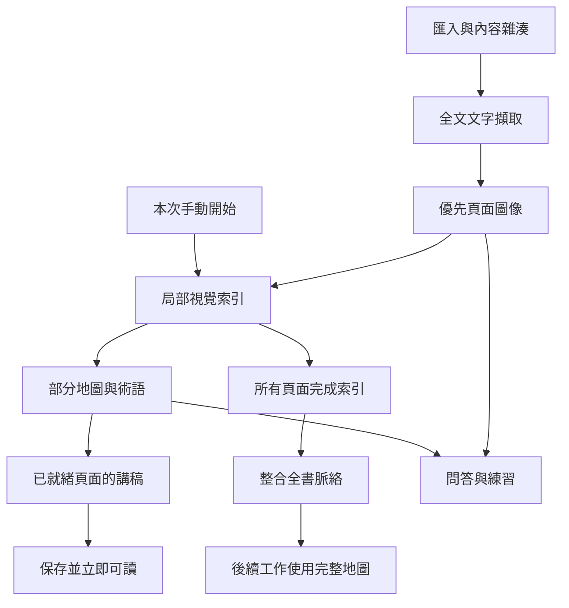
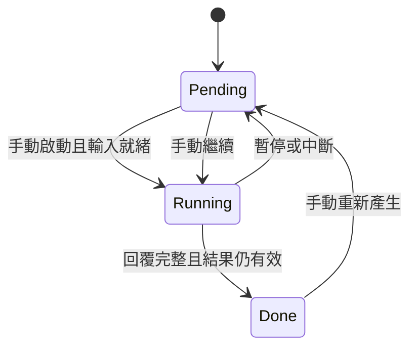

# Study Project Engine：漸進教材理解與有限並行教學生成

> 技術論文式設計說明。對應 **0.9.1**，更新於 **2026-10-26**。本文描述現有系統與驗證結果，不是已發表的學術論文，也不宣稱教學準確率已經過統計實驗證明。

## 摘要

PDF 自學工具同時面臨首段講解延遲、跨頁上下文不足，以及非同步結果錯頁的問題。Study Project 將處理流程拆為本機文字與圖像解析、分段逐頁索引、全書脈絡整合及單頁講稿生成，透過具有容量限制的優先佇列與教材輪替排程，在不等待整份教材完成視覺分析的前提下，產出可立即閱讀的講稿。

本系統以來源頁面與顯式上下文建構每個獨立模型請求，保存生成時的索引版本及覆蓋範圍；以教材物件身分、頁碼與 generationId 防止過期結果回寫。本文說明實作演算法、取消恢復語義、效能模型與控制流程測試。現有證據支持排程與保存行為，尚不足以量化模型教學品質或證明高並行數不影響上游服務表現。

**關鍵字**：PDF 學習、漸進索引、非同步排程、上下文建構、有限並行、可恢復生成。

## 1. 問題定義與設計目標

### 1.1 問題

若每頁只獨立分析原圖，容易忽略前文定義；若先等待整份教材分析完才講解，則增加首次可讀時間。大量非同步工作另有三種風險：結果完成時使用者已翻頁、地圖版本更新造成有效回答被丟棄，以及暫停或刪除後的遲到結果重新寫入。

Engine 的目標是：

1. 已就緒頁面先講解，其餘索引與總覽繼續處理。
2. 實際模型請求共用容量，讓互動問題優先於尚未執行的背景工作。
3. 每個回答依送出時的教材與頁面保存，不依完成時的畫面位置保存。
4. 保留完成快取，以明確的手動操作控制開始、暫停與續作。
5. 明示上下文完整度，避免將局部分析說成已核對全書。

### 1.2 範圍與非目標

Engine 位於 Electron 主程序，核心是 [engine.ts](../electron/engine.ts)。它不是訓練模型的框架、向量資料庫、持久化任務服務或多代理系統。PDF CPU 渲染由獨立 Worker 池負責；模型由 Provider 介面呼叫。Engine 本身不執行 OCR、網頁搜尋、符號驗算或外部工具。

## 2. 系統模型與符號

| 符號 | 定義 | 程式對應 |
| --- | --- | --- |
| `B` | 一份教材及其記憶體物件 | `Book`、`Store.books` |
| `N` | 教材實體頁數 | `book.count` |
| `c` | 目前閱讀的實體頁碼 | `book.currentPage` |
| `P_i` | 第 i 頁的文字、圖像就緒、講稿與問答狀態 | `book.pages[i-1]` |
| `S_t` | t 時刻已完成詳細索引的頁面集合 | `book.map.pages` |
| `M_t` | 當時的索引、術語與總覽快照 | `BookMap` |
| `C` | 模型容量，預設 4、範圍 1–6 | `settings.aiConcurrency` |
| `W` | 每個 PDFLoader 的工作緒目標，預設 2、範圍 1–4 | `settings.pdfWorkers` |
| `J` | 已登記的 Engine 工作，含可能正在等待 Pool 的工作 | `jobs` |
| `g` | 單次講稿或問答生成識別 | `generationId` |

AI 同時請求數是 Provider 呼叫的有限容量，不是 Node CPU 執行緒數。PDF 工作緒則是真正的 Node Worker Threads。多份教材可各有 PDFLoader，因此 `W` 不是所有教材的全域 CPU 工作緒上限；模型容量 `C` 則由所有教材共享。

### 2.1 三種模型工作

| 類型 | 輸入與輸出 | Pool 優先級 |
| --- | --- | ---: |
| Question | 教材上下文、當頁講稿、最近完成問答 → 回答／練習 | 0 |
| Lesson | 當頁上下文與講解偏好 → 單頁講稿 | 1 |
| Index | 頁面文字與圖像 → 局部索引；或完整索引 → 全書總覽 | 2 |

數字越小越優先，同優先級按加入順序。優先級作用於**等待佇列**，不搶占已開始的遠端請求，也沒有永久保留的問答專用槽位。

### 2.2 資料依賴



全書整合不是早期講稿的必要前置條件。上圖是任務資料依賴；模型輸出的 `relatedPages` 只是來源關聯，不被驗證為無環圖，也不作為必須先完成其他講稿的硬排程依賴。

## 3. 方法：漸進教材理解

### 3.1 本機解析與候選頁面

匯入以 PDF 位元組 SHA-256 識別教材；同內容改名仍沿用資料。PDFLoader 的第一個 Worker 先擷取全文文字，再開始圖像渲染，其他 Worker 在文字階段完成後加入。每個 Worker 擁有自己的 PDF 與 Canvas，透過共用 `claimed` 頁碼集合避免同頁重複派工。[來源：PDFLoader](../electron/pdf-loader.ts)、[Worker](../electron/pdf-worker.mjs)。

圖像為 JPEG，品質參數 90；渲染倍率為 `min(2, 1600 / 原頁寬)`。它是模型輸入資產，和 renderer 端即時 PDF 預覽是兩條不同路徑。

頁面排序使用下列分數，取小者優先：

```text
score(i, c) = -1000             if i = c
              i - c - 100       if c < i < c + 10
              i                 otherwise
```

因此優先目前頁、接著後 9 頁，再依頁碼處理其他頁。這不是「只做前 10 頁」：背景啟動後仍會繼續補完整本。翻頁只重排尚未派出的工作，不會僅因閱讀位置改變就中斷已在途請求。

### 3.2 局部索引

`indexChunk()` 只選圖像已就緒、尚未存在於 `mapChunks` 的頁面。第一批最多 2 頁，後續最多 6 頁；選出的頁面可不連續，文字、圖像與頁碼保持同序。

模型透過結構化輸出產生 `page / topic / summary / terms / relatedPages / density`。摘要指示最多 3 個重點、約 120 字；這是生成指示，不是字數裁切器。`density` 為 `brief / normal / dense`。

回傳後 `validateMapChunk()` 檢查預期頁數、頁碼集合、不重複頁碼及欄位型別；來源關聯移除超出實體頁碼範圍的項目。這能攔截結構錯誤，不能判定摘要、公式或概念是否正確。

每批通過後追加 `mapChunks`，`partialMap()` 合併、依頁排序、去重術語，產生 `complete=false` 的地圖並原子保存。`version` 是內容雜湊的前 16 個十六進位字元，用於追蹤來源快照，不是數位簽章或品質分數。

### 3.3 全書整合

當所有頁面已完成局部索引，`finalizeMap()` 將**完整逐頁索引**送入另一次請求，整理 `overview / terms / links`。此步沒有再次附上整本原頁圖像。提示要求每頁最多 3 個重要關聯；後續原頁選取另有硬上限。

輸出驗證通過後將地圖標為完整、`mapStatus=done`。既有講稿不會自動重跑；早期講稿仍保留其建立時的覆蓋範圍，使用者可逐頁要求重新講解。

## 4. 方法：雙層排程與動態補位

### 4.1 外層教材輪替

`wake()` 先同步 Pool 容量，再找出本次 `generationStarted=true` 的教材。未授權時不派送模型工作；已暫停教材跳過。背景工作的啟動採輪替 cursor，每成功排入一份教材的工作，下一輪由其後一份開始。

`activeId` 僅代表閱讀選擇，不會自動使教材加入生成；已由使用者啟動的其他教材可繼續背景執行。

### 4.2 單份教材選擇規則

以下為依原始碼整理的偽程式碼，省略保存與取消處理：

```text
WAKE:
    if stopping: return
    update model pool capacity C
    books ← books explicitly started in this session
    restore partial maps from saved chunks if necessary
    if not authenticated: return

    while registered background capacity permits (|J| < C):
        try books from round-robin cursor:
            skip paused books
            pause books with unrecovered legacy errors
            if SCHEDULE(book) starts a job:
                move cursor to next book; try filling another slot
        if no book can start a job: break

SCHEDULE(book):
    if no question job exists for this book:
        start first eligible pending message, if any
        return started

    n ← next pending, indexed, image-ready page by score
    missing ← image-ready pages not yet in mapChunks, by score
    canIndex ← no index job exists AND map is unfinished AND
               (missing is nonempty OR all pages have been indexed)

    if n exists AND ((preferLesson AND no lesson job exists) OR NOT canIndex):
        clear preferLesson; start one lesson for n
        return started

    if canIndex:
        index up to 2 / 6 missing pages, or finalize the full map
        set preferLesson after successful index job
        return started

    return not started
```

`preferLesson` 讓索引完成後有機會先開始一頁講稿。每份教材最多一個索引 job，因而索引批次本身仍有順序依賴；其他就緒講稿可以與它並行。

新問題的 `ask()` 可直接登記 Question 工作，再等待 Pool。故 `jobs.size` 可能暫時大於 `C`；它不是「真正正在遠端生成的數量」。每份教材同時最多一個已登記的 Question job，畫面上的模型 active / queued 來自 Pool。

### 4.3 內層 Provider 容量

[PriorityPool](../electron/priority-pool.ts) 將等待項目按 `(priority, enqueueOrder)` 排序；只要有容量就執行。當一個 Provider Promise 結束，`active--` 後立刻 `drain()`；Engine job 的 `finally` 另約 30ms 後觸發 `wake()`，登記後續背景工作。

容量固定時，本機執行中的 Provider 呼叫不超過 `C`。若把容量從 6 調成 2，現有 6 個工作不會為此被中斷；降到低於新上限前不再開新工作。此數字不承諾取消指令到達上游前，遠端伺服器的實際運算也瞬間降到相同數量。

### 4.4 為何不是每 6 頁等一輪

假設 6 個講稿已開始，第一頁先完成且後續頁面已完成索引與圖像準備，釋出的容量可立即交給下一頁，不等其他 5 個完成。

然而「槽位空了」不等於必定有合格講稿：首批索引尚未完成、下一頁圖像未就緒、全書整合正在處理、教材暫停或未授權，都可能讓容量沒有填滿。因此本設計不宣稱整條管線在所有時刻都能滿載。

輪替提高教材間的啟動機會，但不等於有嚴格最長等待時間保證；持續高優先問題可能延後背景工作。現版沒有 aging、預留槽位或搶占式排程。

## 5. 方法：每次請求的上下文建構

### 5.1 顯式上下文，而非共用模型記憶

Provider 每次建立新的 ephemeral thread。獨立請求不被假設共享先前對話記憶；必要資訊由 `context()` 明確組合。

| 輸入 | 內容 |
| --- | --- |
| 教材識別 | 名稱、實體頁數與目標頁碼 |
| 脈絡狀態 | 地圖總覽、術語、已詳細索引頁數及是否完整 |
| 早期速覽 | 地圖未完整時，每一頁文字壓縮空白後取前 100 個字串單位；不是整份原文 |
| 目標索引 | 當頁的結構化條目 |
| 原頁證據 | 選中頁面的原始擷取文字，圖像已就緒者附圖 |
| 圖像對應 | 明列附圖順序與實體頁碼 |

`contextPages` 表示當時地圖已索引幾頁，並不表示本次真的附上那麼多張圖，也不是準確率。

### 5.2 原頁集合

一般講稿使用依順序去重的候選列表：

```text
[目標頁, 額外指定頁..., 前一頁, 後一頁, 目標索引.relatedPages...]
```

移除越界頁後，一般請求取前 6 頁；帶練習來源範圍者取前 12 頁。目標頁永遠排在最前，避免關聯太多把它擠出。僅 `imageReady=true` 的頁面附圖，缺圖頁不得被當成已視覺核對。

這不是向量檢索，也沒有自動遞迴展開所有概念前置頁。若來源選取或 OCR 缺失不足，現版主要依提示要求模型表達不確定，沒有額外的自動取證代理。

### 5.3 早期與完整脈絡的差異

早期請求包含部分地圖、部分術語與全文文字速覽；完整地圖完成後改用整合總覽及術語，不再附上該速覽。兩者都攜帶當頁與有限相關原頁。

這是降低首段延遲的取捨：早期內容可能缺少跨頁關聯。系統保存 `contextPages / contextComplete / mapVersion` 讓來源範圍可追溯，但這些標記本身不會修正錯誤。

### 5.4 講稿與互動提示

`lessonGuide()` 以頁面密度及偏好給出軟篇幅。例如精簡模式的 brief 約 40–120 字、normal 約 150–300 字、dense 約 300–600 字。必要定義與推導優先，不硬裁切，也不為封面加入固定章節。[完整設定來源](../electron/lesson-style.ts)。

Question 附加當頁已完成講稿，以及最近 8 筆已完成問答（每筆含問題與回答）；完整紀錄仍留在本機。練習最多 10 頁、5 題，來源範圍保存在訊息；後續回答練習可沿用同頁最近完成練習的來源頁。這不等於建立跨頁的永久模型聊天。

## 6. 正確性條件與保存語義

### 6.1 結果接受條件

對單次講稿，結果接受可概念化為：

```text
Accept(B, i, g) =
    Store.books[B.id] is the same object as B
    AND request was not cancelled / engine stopped
    AND P_i.status = running
    AND P_i.generationId = g
```

教材物件身分很重要：刪除再匯入相同 PDF 雖然雜湊相同，但已是新物件，舊請求不能回寫。講稿使用 `generationId` 接受有效結果，因此地圖增量更新不會僅因版本變化，就丟棄在途的正確頁面回答；保存的 `mapVersion` 仍是該請求建立時的版本。

問答以訊息物件、來源頁面和新的 message generationId 綁定；串流事件亦攜帶教材、頁碼、訊息及生成識別。這些條件保障關聯與過期隔離，不保障生成文字在學術上正確。

### 6.2 狀態機



另有舊資料的 `error` 狀態；續作清除錯誤並恢復可排程狀態。新生成錯誤主要以教材級暫停及 `pauseReason` 表達，而非讓所有剩餘頁逐一失敗。

教材完整判定要求完整地圖、頁數一致，以及全部講稿和訊息均為 done。故講稿計數已達 `N/N`，仍可能因未完成問答或全書整合而未被判為整份完成。

### 6.3 保存與恢復

`Store.save()` 寫入整份教材 JSON 快照：先寫唯一暫存檔並 flush，再 rename 替換；原 PDF 與頁面圖像另存。這降低半份 JSON 被當成正式資料的風險，但不是具有跨檔交易、跨程序鎖或 WAL 的資料庫。

啟動時將 running 恢復 pending，清除前次 `generationStarted`；未完成教材暫停等待手動開始。完成內容保留，不自動重跑。JSON 損毀會明確報錯，不靜默建立空書庫覆蓋。

## 7. 取消、故障與安全邊界

每個工作有 AbortController；取消會移除等待 Pool 的項目，並讓 Provider 送 `turn/interrupt`。如果 `turn/start` 尚未回傳 turnId，取得之後補送中斷，再解除訂閱。[協定實作](../electron/codex.ts)、[協定測試](../tests/codex.test.ts)。

模型、結構驗證或傳輸失敗會暫停受影響教材；連線中斷會暫停仍有未完成工作的已啟動教材。現版不對生成錯誤自動無限重試，需使用者排除原因後按繼續。turn 回覆階段另設 8 分鐘逾時。

暫停本機停止接受進度；遠端中斷仍需傳輸，不保證零延遲停止、用量退還或 token 級續接。PDF Worker 由主程序停止；續作重用已存在圖像，重做未完成頁面或索引批次。

教學指令將教材、圖像和歷史對話視為資料，要求區分原文與補充。Provider 禁用工具、shell、網路搜尋、apps、hooks 與多代理，並拒絕收到的工具 RPC；但內容層的提示注入、幻覺與錯誤摘要仍是殘餘風險。

## 8. 效能模型與取捨

令已就緒工作耗時為 `t_1 ... t_m`。在忽略依賴、傳輸、限流與排程成本的理想條件下：

$$
T_{\mathrm{ideal}} \geq \max\!\left(\max_{1\leq j\leq m} t_j,\; \frac{1}{C}\sum_{j=1}^{m}t_j\right)
$$

固定每 `C` 頁一輪的等待時間則近似各輪最慢工作的耗時總和；上述下界只適用於所列理想條件。

動態補位可減少等待同輪慢頁造成的閒置，但不保證達到上述下界，也不保證服務端吞吐隨 `C` 線性成長。

若不重試、不重新生成且每批輸入充分就緒，索引最少批數可估為：

```text
K_ideal(N) = 1 + ceil(max(0, N - 2) / 6), N ≥ 1
模型請求數 = K_actual + 1 次全書整合 + N 次講稿 + Q 次互動
```

實作可能因當時圖像就緒較少而產生較小批次，因此 `K_actual` 不一定等於理想值；中斷重做還會增加請求。問答每次重新附帶上下文，沒有持久化模型記憶節省機制。

本機索引／排序會遍歷頁面；`orderedPages` 排序約為 `O(N log N)`，整份 JSON 保存也隨講稿與歷史增長。這是目前 Alpha 的可理解實作，尚不是大規模資料庫或最小化 prompt 成本的最佳化解法。

## 9. 驗證與結果

| 證據 | 已支持的結論 | 不能推出的結論 |
| --- | --- | --- |
| 0.9.1 的 74 項自動測試，含可控制 Provider | 並行、取消、錯頁隔離、快取與更新控制流程符合測試條件 | 真實模型準確率、真實網路首段延遲 |
| 多頁亂序完成與問題優先測試 | 結果依原頁保存；等待問題可先於背景佇列 | 已在途請求被搶占、所有工作都有等待上限 |
| PDF Worker 單次歷史量測：191 頁、1 緒 14.67s、2 緒 8.04s | 該機、該教材的本機圖像渲染約快 1.82 倍 | AI 推論也快 1.82 倍、所有電腦都有相同改善 |
| 0.7.1 預覽對照與重載測試 | renderer PDF 生命週期與錯誤恢復修補有效 | Engine 教學品質因此提高 |
| 使用者對現行準確性與速度的正向回饋 | 目前體驗符合該使用情境 | 有盲測、基準資料集或統計顯著性 |

0.8.0 在既有 48 項之外新增 6 項概念複習測試，並完成隔離 Windows 打包介面操作。所有新推論均使用模擬 Provider，未重新進行真實模型效能實驗。完整證據與環境限制見 [TESTING](TESTING.md)、[PERFORMANCE](PERFORMANCE.md)。

## 10. 限制與後續研究

1. **語義正確性**：結構 schema 不是事實檢查；需要跨頁定義、公式與圖表的獨立人工標註。
2. **長文件上下文**：部分地圖時附帶每頁短文字、整合時附完整索引；尚無 token 預算器或階層式摘要溢位處理。
3. **來源挑選**：固定鄰頁與少量關聯可能漏掉較遠的必要定義，尚無向量檢索或證據召回評估。
4. **公平與互動延遲**：沒有預留問答容量、搶占或 aging；需量測飢餓與 p95 延遲。
5. **保存擴展**：大書庫與長對話可能增加整份 JSON 寫入成本，尚無跨程序交易保護。
6. **上游限制**：並行數增加可能導致限流或失敗，不能從本機排程直接推論服務端品質。

後續比較應固定模型、教材、提示與來源快照，將「排程改變」和「上下文改變」分開實驗，量測首份可讀時間、全書完成時間、問答 p50/p95、請求與用量、錯頁率及獨立人工語義正確率。這些是未來驗證方案，不是現有結果。

## 11. 實作與證據索引

- [Engine：排程、地圖、context、lesson、answer](../electron/engine.ts)
- [PriorityPool：容量、FIFO、優先級](../electron/priority-pool.ts)
- [Store：雜湊、原子快照、啟動恢復](../electron/store.ts)
- [完整教材判定](../electron/book-state.ts)
- [密度與講稿長度](../electron/lesson-style.ts)
- [模型橋接與取消](../electron/codex.ts)
- [PDF 派工與渲染](../electron/pdf-loader.ts)、[Worker](../electron/pdf-worker.mjs)
- [核心測試](../tests/core.test.ts)、[協定測試](../tests/codex.test.ts)、[PDF 測試](../tests/pdf.test.ts)
- [閱讀資料測試](../tests/reading.test.ts)、[更新測試](../tests/updates.test.ts)

本文採實作追溯式引證；方法、參數與已列結果均可由上述原始碼或既有驗證紀錄定位。

## 12. 全書完成後的概念複習擴充（0.8.0）

在漸進講稿之外，Reviews 提供需要全書完成的另一種工作：由使用者手動啟動原頁概念擷取與關係整合。兩者共用 PriorityPool；複習沒有加入背景教材自動排程，也不改變單頁講稿補位機制。

其方法為每 4 頁擷取、核對文字引用與圖像來源頁、保存批次，再每 4 組分層合併，最終濃縮為具主題階層及語義連線的圖。整合不能新增未核對的引用；完整圖原子替換，失敗保留舊版。核心不變量是手動啟動、全部教材先完成、引用可追溯、取消後不回寫及成功快取重用。詳細演算法、請求數模型、資料結構與驗證限制列於 [概念複習方法](CONCEPT-REVIEW.md)。

## 13. 閱讀呈現擴充（0.8.1）

本版新增教材首頁、PDF 選取文字層與滾輪邊界翻頁，並在 Markdown 呈現前正規化常見數學分隔符。這些處理位於 renderer，沒有新增推論或變更 Engine 生成內容；既有講稿可直接套用顯示修補。實作與限制見 [READING](READING.md)。

## 14. 概念複習整合可觀測性（0.8.2）

Reviews 將原頁擷取、每層組別及最終整合都納入計畫步數，各層通過驗證的輸出即保存 checkpoint；來源與模型相同時續作跳過已完成組別。Engine.generateReview 仍使用相同 PriorityPool，以執行回呼與 Provider 內容通知區分排隊、處理與接收狀態。活動通知節流送往 renderer，避免每個 token 寫整份教材。這些變更不改變概念擷取與關係核對規則；詳見 [概念複習](CONCEPT-REVIEW.md)。

## 15. 合併輸出驗證恢復（0.8.3）

局部圖 ID 在整合輸入前先給予不同命名範圍，保留內容與引用。所有欄位上限同步到 JSON schema；驗證訊息可定位到具體欄位。完全相同的重複紀錄可去重，衝突 ID 保持拒絕。checkedGraph 僅對驗證失敗做一次附原因的修正請求，成功才保存 checkpoint，兩次失敗保留診斷與進度。模型與引用驗證條件不變；詳見 [概念複習](CONCEPT-REVIEW.md)。

## 16. 科目分組與視圖狀態的分離（0.9.0）

令 G 為群組集合，m: B → G ∪ {未分組} 為教材歸屬；m 獨立於教材內容與 reviewFingerprint。改變 m 不改變講稿、圖或請求依賴，因此不使快取失效，也不啟動任何模型作業。批次移動先驗證所有輸入，成功原子保存整個映射後再發布 UI 變更。跨教材語義整合並未實作。

浮動工具與資訊卡屬於 ReviewView，而非 ConceptGraph；公式適寬縮放是 DOM 顯示變換，不改寫保存公式。此版本沒有改變模型提示、合併算法或來源驗證，故介面測試不能被解讀為新的教學準確率證據。
